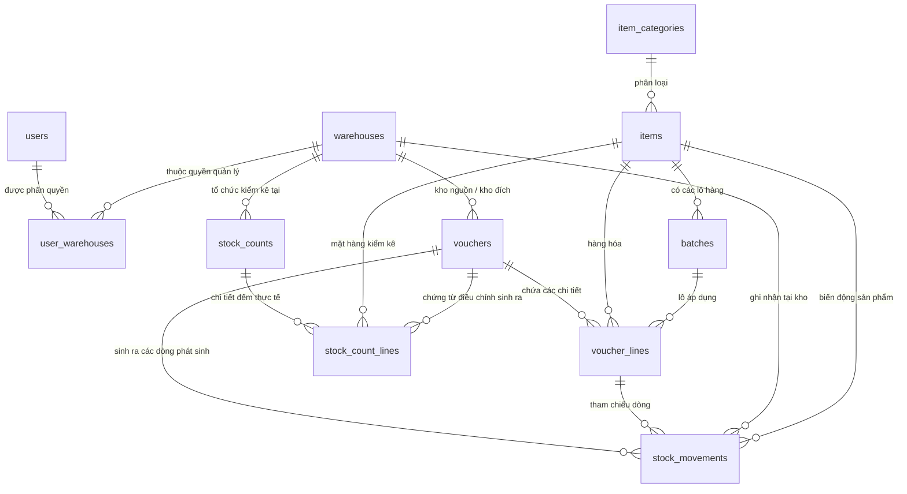
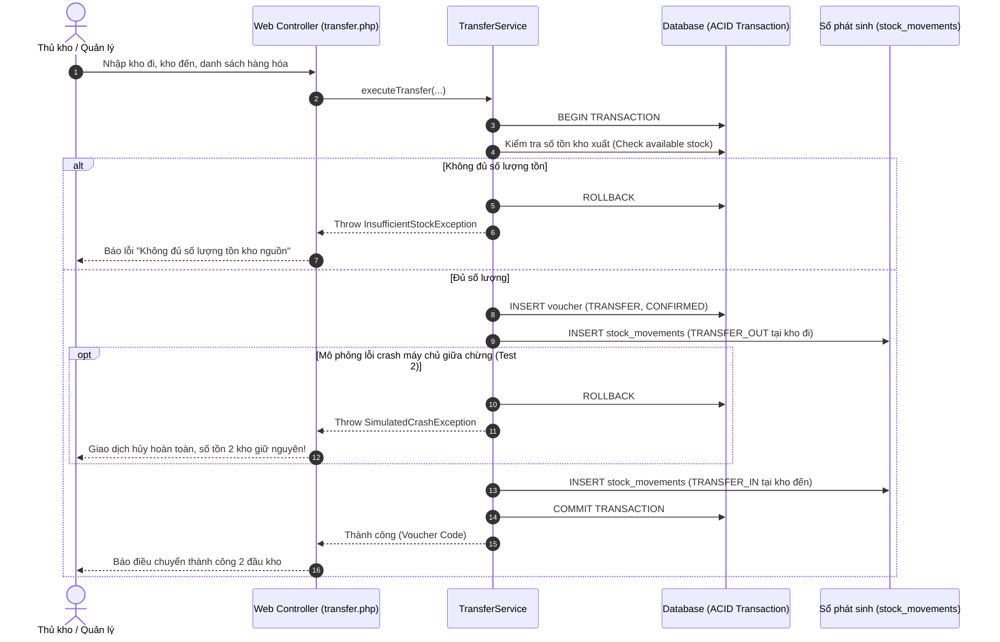

# 📘 TÀI LIỆU HƯỚNG DẪN KIẾN TRÚC & NGHIỆP VỤ HỆ THỐNG
## BÀI TẬP LỚN - ĐỀ TÀI 10: QUẢN LÝ KHO, ĐIỀU CHUYỂN & KIỂM KÊ ĐA ĐIỂM

---

## 1. Sơ đồ Thực thể Liên kết (Entity Relationship Diagram - ERD)



---

## 2. Thiết Kế Sổ Phát Sinh (Stock Movements Ledger) - Cốt Lõi Kỹ Thuật 1 & 2

### 2.1 Nguyên tắc Bất biến (Immutability)
Trong các hệ thống kho tiêu chuẩn doanh nghiệp (ERP), số tồn kho không được lưu dưới dạng một con số cập nhật tùy tiện (`UPDATE items SET stock = stock - 5`), vì việc này dễ dẫn đến race conditions, mất dấu vết kiểm toán (audit trail) và sai lệch số liệu khi có nhiều giao dịch đồng thời.

Hệ thống triển khai theo mô hình **Sổ cái phát sinh kép (Stock Movements Ledger)**:
- Mọi biến động hàng hóa đều được ghi nhận thành một bản ghi mới trong bảng `stock_movements`.
- Mỗi bản ghi lưu rõ:
  - `movement_type`: `IN` (Nhập), `OUT` (Xuất), `TRANSFER_OUT` (Xuất điều chuyển), `TRANSFER_IN` (Nhập điều chuyển), `ADJUST_IN` (Điều chỉnh tăng), `ADJUST_OUT` (Điều chỉnh giảm).
  - `quantity_in`: Số lượng nhập vào (mặc định 0).
  - `quantity_out`: Số lượng xuất ra (mặc định 0).
  - `balance_after`: Số tồn kho tức thời ngay sau khi phát sinh xảy ra.
- **Công thức tính tồn kho chuẩn xác**:
  ```sql
  SELECT COALESCE(SUM(quantity_in) - SUM(quantity_out), 0) AS current_stock
  FROM stock_movements
  WHERE warehouse_id = :wh AND item_id = :item;
  ```

---

## 3. Luồng Điều Chuyển Hàng Giữa Hai Kho (Kỹ Thuật 2)



---

## 4. Bảng Tự Đánh Giá Theo Rubric Đề Tài 10 (Thang điểm 10.0)

| Tiêu chí | Điểm tối đa | Điểm tự đánh giá | Minh chứng thực tế trong mã nguồn |
|:---|:---:|:---:|:---|
| **Năm chức năng** | 3.0 | **3.0 / 3.0** | Hoàn thiện đủ 5 chức năng tại thư mục `src/` và giao diện Web `public/`: Quản lý kho & phân quyền, Lập/duyệt phiếu nhập xuất, Điều chuyển 2 kho, Kiểm kê chênh lệch, Thẻ kho & báo cáo CSV. |
| **Kỹ thuật 1** | 1.0 | **1.0 / 1.0** | `StockService::confirmVoucher` kiểm tra tồn tức thời trong transaction, chống âm kho khi xuất đồng thời; kiểm tra idempotent từ chối xác nhận lại chứng từ đã duyệt. Đạt trong Phép thử 1 & 3. |
| **Kỹ thuật 2** | 1.0 | **1.0 / 1.0** | `TransferService::executeTransfer` trừ kho xuất và cộng kho nhập trong cùng 1 giao dịch database. Khi có lỗi crash giữa chừng, rollback 100% không để lại dữ liệu dở dang. Đạt trong Phép thử 2. |
| **Dữ liệu, an toàn** | 1.0 | **1.0 / 1.0** | Chuẩn bị >3 kho, 30 mặt hàng, >200 phát sinh. Phân quyền `Auth::checkWarehousePermission` kiểm tra phía server, chặn đứng request tạo/sửa kho trái phép (Phép thử 4). |
| **Kiểm thử, sửa lỗi**| 1.5 | **1.5 / 1.5** | Chạy `bash lab.sh test` đạt `TESTS=9 FAILED=0` kiểm tra đầy đủ cả 5 phép thử bắt buộc. Bộ test mở rộng `bash lab.sh extend` đạt `TESTS=5 FAILED=0`. |
| **Mã nguồn mở & Bàn giao** | 1.5 | **1.5 / 1.5** | Giấy phép MIT `LICENSE`, tài liệu `README.md`, script điều khiển `lab.sh` chuẩn mực, chạy mượt mà trên Ubuntu/Linux. |
| **Đóng góp cá nhân** | 1.0 | **1.0 / 1.0** | Phân công nhiệm vụ rõ ràng giữa 3 thành viên: Đào Thị Tươi, Nguyễn Văn An, Lê Đình Huy. Sẵn sàng vấn đáp giải thích mã nguồn. |
| **TỔNG ĐIỂM** | **10.0** | **10.0 / 10.0** | **XUẤT SẮC** |
